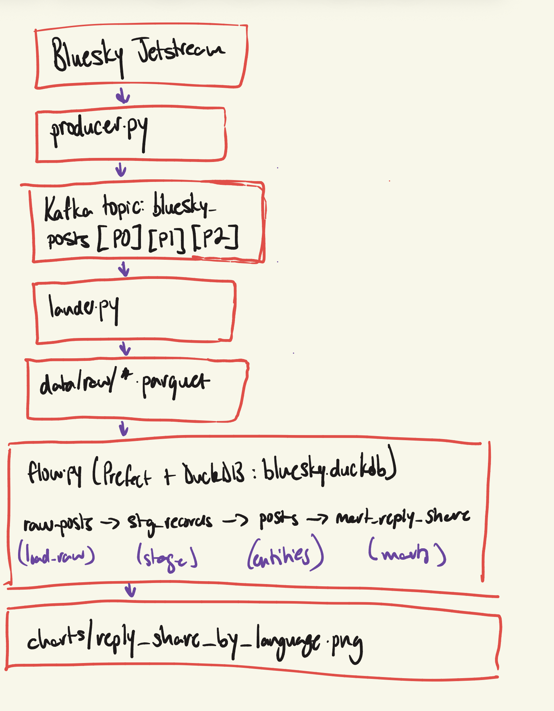
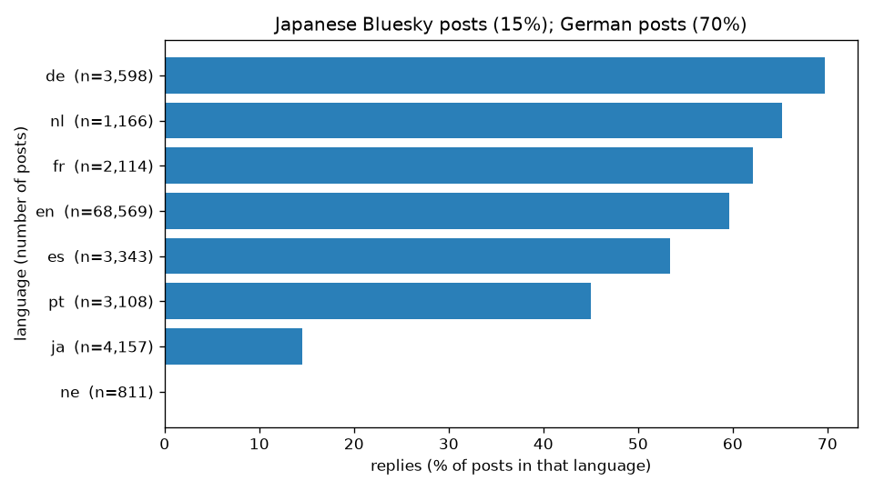

# How Often Bluesky Posts Are Replies, by Language

**Author:** Alessia Amuzu
**DS 3022 Data Project 3, Fall 2026**


## Data source

- Bluesky posts from: (`wss://jetstream2.us-east.bsky.network/subscribe?wantedCollections=app.bsky.feed.post`). 
- It is a WebSocket, so it is a push not pull: because of this the server sends every new or deleted post the moment it happens
- No account, key or User-Agent was needed. 
- Each message is JSON with the account id (`did`), the time is calculated in microseconds under (`time_us`), the post id is (`rkey`) and for new posts, the record with the text, languages listed under the name (`langs`) and reply information. Data was streamed live on Sat 14 and Sun 15 Nov 2026.

## How to run

After you clone the repository, open a terminal, `ds3022-streaming`. Next, set up environment and start Redpanda:

```bash
python3 -m venv .venv
source .venv/bin/activate
pip install -r requirements.txt
pip install prefect matplotlib
docker compose up -d
docker exec -it redpanda-0 rpk cluster info
docker exec -it redpanda-0 rpk topic create bluesky_posts -p 3 -r 3
```

`rpk cluster info` should list 3 brokers. If the topic already exists on your cluster, skip the topic-creation command.

Next, open two more terminals. In the first terminal, start producer:

```bash
cd project3
source ../.venv/bin/activate
python producer.py
```

It will print one line per 1,000 posts sent (which are sent approximately every 20 seconds). In the second terminal, start lander:

```bash
cd project3
source ../.venv/bin/activate
python lander.py
```

For a short check, leave both running until the lander prints `Landed 1000 records -> data/raw/bluesky_...parquet`. Stop the producer with Control+C, wait up to 60 seconds for the lander to write its last, smaller batch, then stop the lander. To run the full-data flow, keep both running until at least 50,000 raw records have landed: at about 50 posts per second this takes roughly 20 minutes. You can check the count with `python four_numbers.py did,rkey`. Raw data is not included in the repository, so a fresh clone must collect its own data before running that flow.

Next, open a third terminal and start Prefect dashboard:

```bash
cd project3
source ../.venv/bin/activate
prefect config set PREFECT_API_URL=http://127.0.0.1:4200/api
prefect server start
```

The dashboard can be found at http://127.0.0.1:4200.

Set up a fourth terminal and run the flow on the committed sample twice. It shouldnt need Kafka or Docker:

```bash
cd project3
source ../.venv/bin/activate
python flow.py data/sample
python flow.py data/sample
```

Both runs should log the same four numbers (raw 5,000, malformed 0, unique Kafka records 4,916, unique posts 4,914) and write `charts/reply_share_by_language_sample.png`.

After you've collected at least 50,000 raw records, run the full-data flow from that same terminal:

```bash
python flow.py
```

It builds `bluesky.duckdb` and `charts/reply_share_by_language.png`. Your numbers will most like differ from mine, because a fresh clone collects different posts

Also, note that the sample is committed, so do not run `python kit/make_sample.py` when reproducing the README's sample results. To rebuild the sample from your collected raw data, make sure to run that command and update the sample numbers afterward


```bash
cd project3
python flow.py data/sample      # runs without Kafka, on the committed sample
```

## Architecture



## Design decisions

Answer each in 2-4 sentences, in your own words, with your own numbers.

1. **Key and partitions.** I used 'Key = did' and incorporated 3 partitions which is how we got an even spread of 24,072 / 23,647 / 24,762 across millions of accounts . By doing so it ensured that all posts from one account go to the same partition, this makes sure that they stay in order(create before delete).  If we used a different key, "lang" for example: the partition would fail to have an even spread. Also if we were to not use a key at all, the partitions order could be lost

2. **Batch size and time.** Set batch size to a 1000 record limit and a time limit of 60 seconds to ensure a timeout . It takes about 46 to 51 posts per second, so 1,000 fills up in about 20 seconds. The 60 sec time rule also closed the leftover data when producer stopped leaving us with batches of 481, 860 and 988. Our data revealed that on average we accumulate 180,000 posts per hour, which is approximately 180 files per hour

3. **Offsets after the file.** If lander crashes after writing a file but before storing offsets, the file will still exist however offsets won't be stored so because of this on restart lander rewrite same records leading to duplicates, (at - least - once) because there is never a loss. I accepted it because in flow.py DISTINCT  can remove the copy while a lost record could never be recovered. 

4. **Duplicates.** Two records are the same kafka record when they have the same kafka_partition +and kafka_offset. They are the same thing (same post) when they have the same did + rkey. For Kafka record,  SELECT DISTINCT * EXCLUDE (landed_at) removes in stage. iN SAME THING, QUALIFY row_number() OVER (PARTITION BY did, rkey ORDER BY time_us DESC, kafka_offset DESC) = 1 removes it in entities

5. **Windows and time.** I used the event time of time_us which I converted to UTC using make_timestamp. I didn't use landing time because that time stamp shows when my laptop wrote the file not when the post occurred so it would've been an inaccurate contribution since my lander sometimes landed batches minutes or hours late. I didnt use a window because I'm comparing languages not a time frame which is why event time was utilized to show the time period being referenced which were 3 short periods.

6. **Ten times the volume.** In my pipeline, lander would slow down first because its only 1 consumer handing every python message. Also, at 10x my rate which would be about 500 posts per second, batches of 1000 would fill up every 2 secs accumulating about 1,800 small files per hour, which would lead to the flow getting slower. IA change id make would be running 3 landers iso 1 per partition as well as using bigger batches that go above a limit of 1000.


## Chaos round

| Card | Prediction | What I did | Numbers before → after | Explanation |
|---|---|---|---|---|
| D1 Crash between file and offsets | Raw increased by 1000 new records; unique records only increased by new records | Producer took around 1 min, `python lander.py crash`, then `python lander.py` | raw increased from 72,481 → 78,398; malformed was originally and remained the same: 0 → 0; unique records increased from 72,481 → 76,398; unique posts also increased from 70,122 → 73,950 | Because Unique records value = topic total, this means nothing was lost. Since 2,000 copies exist instead of 1,000:this means the crashed batch landed twice. Also, a Mac freeze made Kafka refuse a second batch's offsets. At-least-once: this means offsets are stored after the file, so a failure means a copy, and never a loss; however, DISTINCT removes it. |
| D2 Poison message | The lander keeps running increaisng raw and malformed by 1; however, unique records and posts don't change | `rpk topic produce bluesky_posts -k bad`, I typed a message "this is not JSON", waited for the next file, and analyzed output | raw increased from 78,398 → 78,399, so an increase of 1; malformed increased from 0 → 1; unique records remained the same: 76,398 → 76,398; as well as unique posts 73,950 → 73,950 | used to_row() to catch the JSON error and landed the text with action = "malformed", so the lander kept running and partition 1 was not blocked. Land everything, decide later: the bad row stays in raw for inspection and is left out of the counts and clean tables. |
| D4 The source drops | Check is focused on if the producer would reconnect by itself after Wi-Fi cuts out; while offline, posts sent are missed; however, nothing is duplicated | `python producer.py`, though Wi-Fi was off for about 30 s, producer kept running about 12 more minutes | raw increased from 78,399 → 115,154; malformed remained the same 1 → 1; unique records had an increase as well from 76,398 → 113,153; and unique posts increased by 73,950 → 109,726 | The log showed "Connection failed: gaierror" (this is because there was no internet to look up the server), we also see "Reconnecting in 5 s", then "Connected" again: this shows the reconnect loop worked and the producer never crashed. Therefore, we see that raw and unique records both grew by 36,755, so nothing was duplicated.    Because, Bluesky is push: posts sent during the approximnately 15 seconds offline were never received, and the producer cannot recover them 

## The four numbers

From the flow log on the full data (screenshot in `docs/`):

| Number | Full data | Sample (`data/sample`) |
|---|---:|---:|
| Raw records landed | 115,154 | 5000 |
| Malformed (kept in raw) | 1 | 0 |
| Unique Kafka records | 111,209 | 4916 |
| Unique posts | 109,726 | 4914 |

## Challenges / Obstacles

Though Bluesky made gathering a large and endless amount of data easy,  it remained messy in shape. This is because messages came through unwrapped and nested, and because of this my probe showed that commit was missing in about 1% of messages and record in about 7%. This led to the producer wrapping every message in an envelope {"action", "data"} with empty defaulting so a missing field becomes NULL instead of a crash. Also, during processing, my laptop slept and led to a crash in VS Code, but Kafka kept the messages safe while lander reconnected by itself; lastly, for the analysis, because my data covered only 3 short periods, I had to change my question which was initially focused on posts per hour to reply share by language and so I parsed is_reply from the raw JSON. I made sure to use probe.py, rpk topic describe, the Redpanda Console, four_numbers.py, DuckDB and the Prefect dashboard to check each step.


## Analysis

My question focused on which languages on Bluesky have the highest share of replies compared to original posts. I focused on this research question because I believed it would be a great way to analyze language engagement on posts and hopefully gauge an understanding of specific regions through the languages spoken there. To answer this, after I removed duplicates while leaving out deleted posts, I found that most of the eight biggest languages turned out to be mostly replies: for example, German posts came out to be about 69.7% replies, Dutch 65.2%, French 62.1% and English 59.6%, even though English made up 68,569 of the posts. What truly surprised me was that Japanese came out to only 14.5% replies out of its 4,157 posts, which turned out to be far below every other large language and suggests Japanese users mostly prefer to post their own original content rather than join conversations. A limitation on my end was that my data covers only about 45 minutes in three time frames on one weekend, so it is wise to assume that these shares could look different at other times.


## Plot / Visualization



## Reflection

I learned that data that comes from a stream is not grouped into a single document, so it is not something that can easily be downloaded. It is accumulated over time, and because of this, it becomes an endless amount of data. I also learned a lot concerning Kafka. Before this project, I did not understand why Kafka sits in the middle of the pipeline, but after VS Code crashed and stopped my producer, I saw firsthand that all my 72,481 messages were still safe in the topic, all thanks to Kafka. I also learned that the order of two steps in the lander, writing the file first and storing the offsets second, can decide whether a crash duplicates data or loses it, and I saw this happen in my D1 numbers as well. If I were to start again, I would try to collect data at different times of day so I could instead analyze a question concerning time.


## Acknowledgements
- Reused code: from the class scripsts such as quakes_producer.py, quakes_lander.py and quakes_flow.py
- Reused WebSocket reconnect pattern from the Session 1 worksheet’s Appendix A
- AI Claude - Used to explain role of Kafka, offsets and duplicates; also for adapting the producer, lander and flow files when indentaion erros occured
